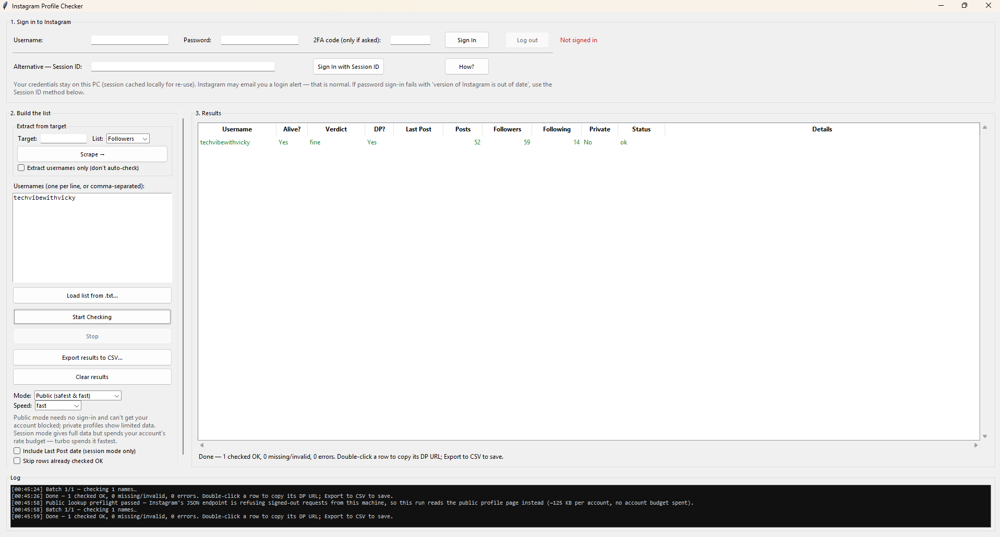
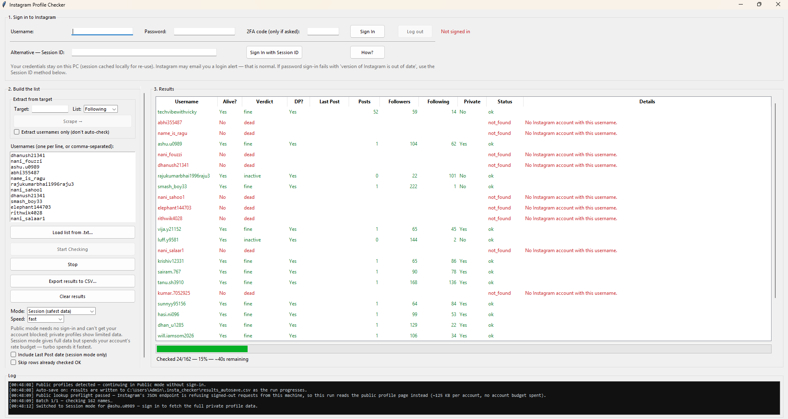

# Instagram Profile Checker

Analyze any Instagram username from a list — is the account alive, does it look fake, when did it last post — and export the audit to CSV. A Windows desktop app with two ways to fetch data: **Public mode** (no sign-in at all) and **Session mode** (full data through your account).

**Every row gets a transparent verdict with its reason. Failed checks get no verdict at all — guessing would erode trust.**

<!-- Screenshots: uncomment as files land in docs/screenshots/
<p align="center">
  
</p>
<p align="center">
  
</p>
-->


## The verdict column

| Verdict | Rule (exactly what the code checks) |
|---|---|
| `likely-fake` | no profile picture **and** 0 posts |
| `suspicious` | following ≥ 100 with following ≥ 20× followers, **or** no profile picture with ≤ 3 posts |
| `inactive` | 0 posts, **or** last post older than 90 days |
| `dead` | the username doesn't resolve at all (deleted, renamed, banned, never existed) |
| `fine` | everything else |

Rows are colored by verdict in the table. A row whose check **failed** carries no verdict — only a status and the error.

## What you get per account

| Column | Meaning |
|---|---|
| **Username** | as checked (invalid inputs are flagged, not silently "fixed") |
| **Alive?** | does the username resolve to a profile |
| **Verdict** | the label above, with the reason written into the CSV |
| **DP present?** | has the account uploaded its own profile picture — blank means *unknown* (Instagram withholds the avatar of a private profile you don't follow; reading that as "no photo" would brand real accounts fake) |
| **Last Post** | date of the most recent post, when visible (Session mode) |
| **Posts / Followers / Following** | the counters |
| **Private / Verified** | flags |
| **Status, Error** | what happened to the row |

Results export to **CSV** that opens directly in Excel.

## Quick start

1. Install [Python 3.11+](https://www.python.org/downloads/) — tick **"Add Python to PATH"** during setup.
2. Double-click **`run.bat`**.
   The first run creates a local `.venv`, installs the required libraries, and opens the app.
   (Double-clicking it again while the app is open is safe: the second copy says so and closes rather than quietly overwriting your saved results.)
3. Pick a mode, paste usernames (one per line, or comma / semicolon / tab separated), click **Start Checking**.
4. Click **Export results to CSV…** when finished.

> A space is *not* a separator: `bad name` stays one row marked invalid instead of silently becoming two real lookups on two wrong accounts.

### Build a standalone .exe (optional)

Double-click **`build_exe.bat`** — it prepares the venv, installs PyInstaller, and produces `dist\InstagramProfileChecker.exe`: one file you can copy to any Windows PC. The exe is a frozen snapshot: re-run the build after editing anything in `insta_checker\`.

### Moving this folder to another PC

Copy the whole folder, but **do not copy the `.venv` folder** — a venv records the absolute path of the Python that created it. You don't have to manage that yourself: `run.bat` detects a venv that doesn't work on this PC, throws it away, and builds a fresh one.

## Two modes

### Public mode — safest, no account involved

Reads the logged-out profile data Instagram's own web frontend serves. **No account, session, or cookie is touched** — your account cannot be throttled or banned by this mode; only your IP can face a temporary cool-down.

Two signed-out paths, chosen automatically per run:

1. **The JSON endpoint** behind Instagram's web app (`web_profile_info`) — small (~2 KB per account) and exact.
2. **The logged-out profile page** (`instagram.com/<username>/`) — used when Instagram refuses the JSON endpoint from your machine (the common case on home/campus IPs). Same numbers from the page's embedded payload.

**A run starts with a preflight:** it probes the endpoint with a username that cannot exist and, if refused, proves the page path still serves data for a known-real account. Only if **both** fail does the run stop — with a full explanation — *before anything from your list is sent*. Nothing checked, no account involved.

**Honest limits of Public mode:** no Last Post date (needs a session); the page path moves ~125 KB per account over the wire (~750 KB rendered), so a 1,000-name run is roughly 125 MB of traffic; post counts above ~10,000 arrive abbreviated from Instagram and are left blank rather than rounded.

### Session mode — full data

Signs in and gets everything visible to your account, including private profiles you follow and the Last Post date. This spends **your account's** rate budget.

- Sign in with username + password; if Instagram asks for a 2FA code, enter it in the **2FA code** field and press **Sign In** again.
- If sign-in fails with *"Your version of Instagram is out of date"* (a known upstream issue with emulated app logins), use the **Session ID** method: click **How?** and follow the steps (copy the `sessionid` cookie from a browser where you're logged into instagram.com).
- A session is cached in `%USERPROFILE%\.insta_checker` so you don't sign in every time. The **Log out** button signs out on Instagram's side *and* deletes the cached file — refused while a check is running, always asks first.
- **Use a dedicated throwaway account for checking — never the one you use daily.**

## Follower audit

Type a **target username**, pick **Following** or **Followers**, and click **Scrape followers →**. The list lands in the username box (200 per page, live progress, Stop works between pages). Then:

- **Extract usernames only** — tick the checkbox first: you get just the list in the box (copy it, save it, check it later); no analysis performed.
- **Full audit** (default) — every follower is checked through the normal pipeline automatically.

Follower lists only come from the signed-in API: the button is disabled without sign-in, and the mode is forced to Session for the audit. Because a scrape **replaces** whatever is in the box (no undo), the app asks first if you already have a list there — cancelling costs no requests.

**Pacing and blocks, handled for you:**

- Scrape attempts are spaced automatically — **60 s between clicks normally, 10 minutes while a block is active**. The app refuses to hammer the button on your behalf.
- A `feedback_required` block (Instagram pausing scraping activity) keeps every name already retrieved, explains the situation, and is remembered even across restarts — you'll be asked to confirm before scraping again too soon. The block is temporary (hours to ~48 h); waiting is the only fix.
- If Instagram rate-limits a scrape mid-way, the app keeps the names retrieved and **remembers the page it stopped on** — scrape again later and it offers to **resume from there**, never re-requesting fetched pages.

## Speed & big lists

| Preset | Workers | Pause between requests | Risk |
|---|---|---|---|
| `safe` | 2 | 0.8–1.5 s | Lowest |
| `fast` *(default)* | 4 | 0.25–0.6 s | Moderate |
| `turbo` | 6 | 0.15–0.35 s | High |
| `lightning` | 10 | 0.05–0.15 s | Extreme — action-block risk |

- All workers share one session, so faster presets raise throttle risk; the app strips the underlying library's hidden 2–4 s per-request sleeps, so every preset is several times faster than stock at the same request count. For personal lists, `fast` checks ~100 accounts in under a minute.
- **Big lists (300+)** are split into batches with 20–40 s quiet cool-downs between them — a 3,000-follower audit doesn't look like a bot burst. Applies to both modes.
- **Checkpointing:** every result is written to disk as it lands. Close the app or crash mid-run, restart, tick **"Skip rows already checked OK"** (the app ticks it for you after a halt) and continue where you left off. **"Clear results"** wipes the table and the checkpoint.
- **Circuit breaker:** when several consecutive lookups are refused with nothing succeeding in between, the run **halts with an explanation** instead of retrying through it — sustained retry traffic is exactly what escalates to an action block. Wait 15–60 minutes, then resume from the checkpoint.
- The username box itself is saved too (`pending_names.txt`): a crash or block mid-scrape never costs you the extracted names, and closing the window saves the box plus every checked row.
- **Last Post** costs one extra request per account (Session mode) — untick it for the fastest run; alive/DP/counts are unaffected.

## Notes & limits

- **Credentials never leave your PC** — they are used only to talk to Instagram. Nothing is sent anywhere else.
- Private accounts expose counters but not posts; deleted/renamed usernames show as `not_found`.
- The engine is [instagrapi](https://github.com/subzeroid/instagrapi) (unofficial) — when Instagram changes its internal API, update it with `pip install -U instagrapi`.
- This tool is for checking accounts you are permitted to review. Use responsibly and within Instagram's terms — aggressive checking can get the signing-in account temporarily blocked or flagged.

## Project layout

```
run.bat                 # one-click launcher (self-healing venv)
build_exe.bat           # builds a standalone .exe with PyInstaller
requirements.txt        # runtime dependencies
requirements-dev.txt    # PyInstaller for exe builds
insta_checker/
  app.py                # Tkinter desktop GUI + all local persistence
  checker.py            # sign-in, profile fetching, verdicts, CSV export
  followers.py          # follower-list scraping: own pagination, resume, stoppable
  public_lookup.py      # signed-out lookup: JSON endpoint + page fallback
  tests/
    test_checker.py        # parsing, DP detection, verdicts, CSV, batching
    test_public_lookup.py  # signed-out payload mapping
    test_app.py            # headless Tk tests: file loading, summaries, scrape box
```

## Related

- [instagram-followers-scraper](https://github.com/amanvicky/instagram-followers-scraper) — the sign-in-free sibling: collect public follower/following lists in a browser UI and export to Excel.
